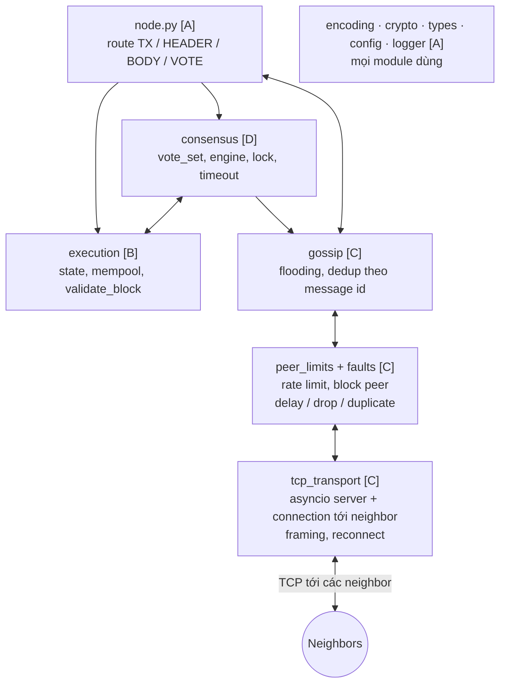
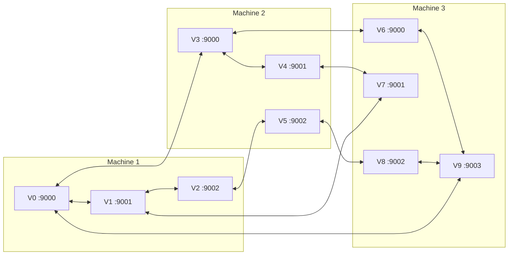
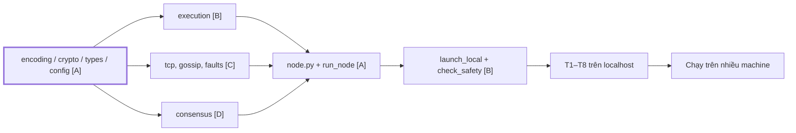
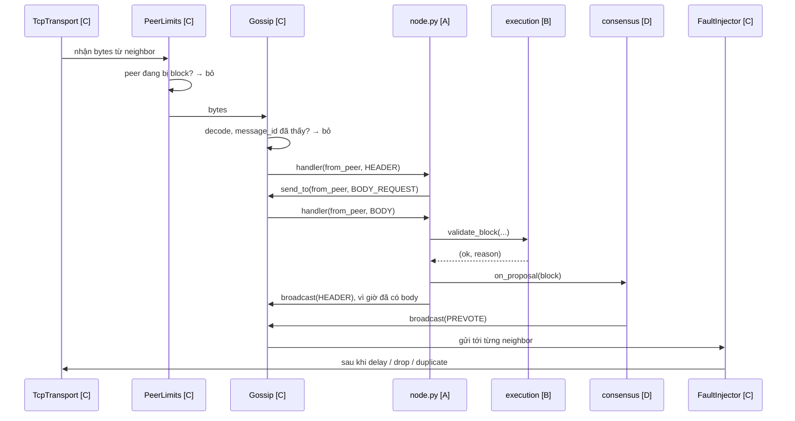
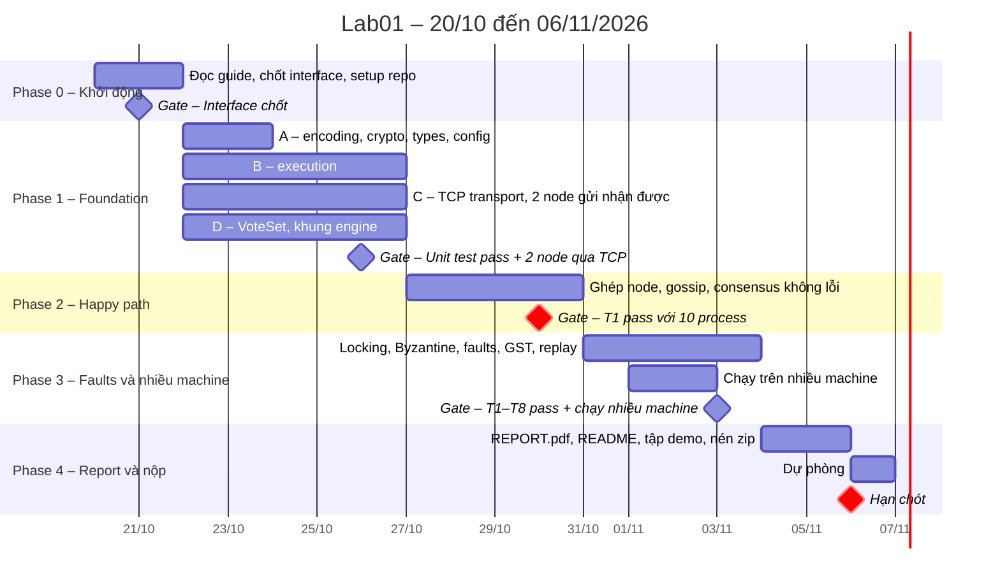
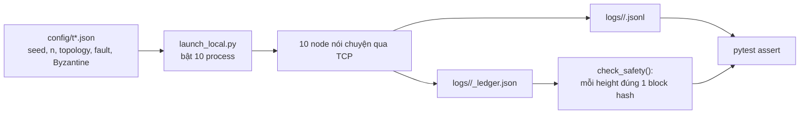
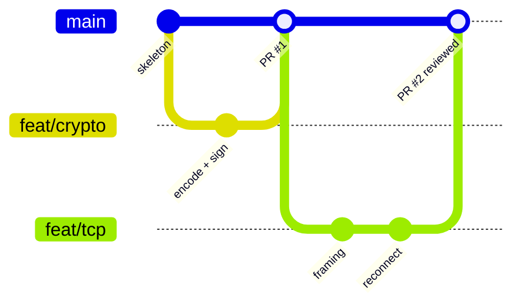

# Lab01 – Team Plan

> Kế hoạch làm Lab01 cho nhóm 4 người. Hạn nộp **06/11/2026**, nhóm nhắm nộp **05/11**. Ai chưa rõ thuật ngữ: đọc [`CONCEPT_GUIDE.md`](./CONCEPT_GUIDE.md) trước, tối thiểu Tầng 1–4.

## Mục lục

1. [Mục tiêu & definition of done](#mục-tiêu--definition-of-done)
2. [Kiến trúc & cấu trúc thư mục](#kiến-trúc--cấu-trúc-thư-mục)
3. [Interfaces giữa các module](#interfaces-giữa-các-module)
4. [Phân công](#phân-công)
5. [Timeline](#timeline)
6. [Testing plan](#testing-plan)
7. [Quy ước code, determinism, git](#quy-ước-code-determinism-git)
8. [Report, vấn đáp & submission checklist](#report-vấn-đáp--submission-checklist)
9. [Rủi ro, quyết định đã chốt & câu hỏi đang chờ](#rủi-ro-quyết-định-đã-chốt--câu-hỏi-đang-chờ)

---

## Mục tiêu & definition of done

Xây một blockchain Layer 1 mini bằng **Python** theo mô hình **peer-to-peer**: mỗi node là một process riêng, chạy trên nhiều machine, chỉ mở TCP connection tới các **neighbor** khai báo trong config file, và chuyển message tới mọi node bằng **gossip**. Consensus theo kiểu **Tendermint**: Propose → Prevote → Precommit, có locking. Mọi honest node phải finalize cùng chuỗi block dù network bị delay, drop, duplicate và có tới f node Byzantine.

**Coi là xong khi:**

- [ ] `python -m lab01.run_node --id V3 --config config/topology.json` chạy được một node.
- [ ] `python -m lab01.launch_local --scenario config/t1_normal.json` bật 10 node trên 1 machine, mỗi node một process với port riêng, và mọi node finalize cùng chuỗi block.
- [ ] Chạy được trên nhiều machine: laptop của các thành viên hoặc nhiều VM trên một laptop, có log của từng node làm bằng chứng.
- [ ] `python tests/run_tests.py` chạy toàn bộ unit test và T1–T8, tất cả pass.
- [ ] README.md hướng dẫn cài đặt, chạy trên 1 machine, chạy trên nhiều machine, chạy test.
- [ ] REPORT.pdf viết bằng tiếng Việt, tối đa 10 trang, đủ các mục đề yêu cầu, không chèn source code.
- [ ] Nộp đúng tên `Lab01_ID1_ID2_ID3_ID4.zip` với `src/ tests/ logs/ config/ README.md REPORT.pdf`.

**Ngoài phạm vi:** gas, fees, smart contract, RPC/API cho client, light client, sync modes, lưu dữ liệu xuống disk, peer discovery, TLS, NAT traversal. Riêng việc kết nối qua Internet còn chờ câu trả lời của giảng viên.

---

## Kiến trúc & cấu trúc thư mục

Mỗi node là một process Python dùng `asyncio`. Một process xử lý được nhiều TCP connection cùng lúc mà không cần tự quản lý thread; chạy song song thật đến từ việc có nhiều process trên nhiều machine.

Các lớp bên trong một node:



*Chữ trong ngoặc vuông là người phụ trách. Mũi tên là "gọi tới".*

Khi deploy trên nhiều machine:



*Ví dụ 10 node trên 3 machine. Các cạnh lấy từ `config/topology.json`. Khi phát triển hằng ngày, chạy cả 10 node trên 1 machine bằng cách đổi mọi `host` thành `127.0.0.1`.*

### Quyết định kỹ thuật đã chốt

| Hạng mục | Chọn | Lý do |
| --- | --- | --- |
| Ngôn ngữ | Python 3.11+ | Giảng viên khuyên không dùng C/C++; dataclass, typing, asyncio tốt |
| Kết nối | TCP bằng `asyncio` | Nhiều connection trong 1 process, không cần tự quản lý thread |
| Song song | Mỗi node 1 process, nhiều machine | Song song thật ở mức process, không bị GIL giới hạn |
| Framing | 4 bytes độ dài big-endian + bytes từ `encode()` | Đơn giản, dễ debug |
| Truyền tin | Gossip flooding, dedup theo `sha256` của message | Node chỉ nối tới neighbor |
| Topology | JSON file trong `config/`: host, port, các cạnh nối | Đề cho phép file-driven; đổi machine chỉ cần đổi config |
| Network không ổn định | Fault injection layer: delay, drop, duplicate theo config + seed, có `gst_time` | Bắt buộc cho T2, T5 |
| Signature | Ed25519, thư viện `cryptography` | Chữ ký deterministic, nhanh |
| Hash | SHA-256, `hashlib` | Có sẵn |
| Encoding | Canonical JSON: `sort_keys=True`, `separators=(",",":")`, bytes → hex | Dễ debug, dễ đọc log |
| State commitment | `sha256(encode(sorted state))` | Đủ cho lab, không cần Merkle tree |
| Số node mặc định | 10 validator: n = 10, f = 3, quorum = 7; mỗi node ít nhất 4 neighbor | n = 3f + 1 và ≥ 8 node; ≥ f + 1 neighbor để Byzantine node khó cô lập một node |
| Proposer | `validators[(height + round) % n]` | Deterministic, node nào cũng tự tính được |
| Test | `pytest` | Chuẩn |
| chain_id | `"lab01"` | Dùng trong domain tag |

### Cấu trúc thư mục

```
Lab01_ID1_ID2_ID3_ID4/
├── src/lab01/
│   ├── encoding.py          # encode, decode, sha256_hex, message_id    [A]
│   ├── crypto.py            # keygen từ seed, sign/verify có domain      [A]
│   ├── types.py             # Tx, BlockHeader, Block, Vote, Message      [A]
│   ├── config.py            # đọc topology + scenario JSON              [A]
│   ├── logger.py            # log JSON lines, mỗi node 1 file           [A]
│   ├── node.py              # ghép mọi thứ, route message               [A]
│   ├── run_node.py          # chạy 1 node = 1 process                   [A]
│   ├── launch_local.py      # bật N process trên 1 machine, gom log     [B]
│   ├── execution/
│   │   ├── state.py         # State, apply_tx, apply_block, state_hash   [B]
│   │   ├── mempool.py       # hàng chờ tx, chống trùng                   [B]
│   │   └── validation.py    # validate_tx, validate_block (rule 3)       [B]
│   ├── consensus/
│   │   ├── vote_set.py      # đếm vote, dedup, phát hiện equivocation    [D]
│   │   ├── engine.py        # Tendermint state machine, lock, timeout    [D]
│   │   └── byzantine.py     # hành vi xấu: silent, equivocate, replay    [D]
│   └── network/
│       ├── tcp_transport.py # asyncio server/client, framing, reconnect  [C]
│       ├── gossip.py        # flooding + dedup theo message id           [C]
│       ├── faults.py        # delay/drop/duplicate theo seed, GST        [C]
│       └── peer_limits.py   # rate limit, block/unblock peer             [C]
├── tests/
│   ├── run_tests.py         # entry point duy nhất cho mọi test          [A]
│   ├── check_safety.py      # đọc ledger mọi node, so block hash        [B]
│   ├── check_determinism.py # T8, cách làm chờ giảng viên trả lời        [B]
│   ├── unit/
│   └── e2e/                 # T1–T8: bật process thật trên localhost
├── config/                  # topology.json, topology_local.json, t1_normal.json ... t8.json
├── logs/                    # log của từng node, từng scenario
├── README.md
└── REPORT.pdf
```

Thứ tự phụ thuộc giữa các module:



*`encoding / crypto / types` là nút cổ chai: A phải xong trong 2 ngày đầu Phase 1. Trong lúc chờ, những người khác dùng stub.*

---

## Interfaces giữa các module

Đây là "hợp đồng" để 4 người code song song. **Chốt trong buổi họp 21/10; muốn đổi sau đó phải báo cả nhóm và cập nhật file này.** Module người khác chưa xong thì viết stub theo đúng signature.

### types.py (A viết đầu tiên, mọi người dùng)

```python
@dataclass(frozen=True)
class Tx:
    sender: str          # tên participant, vd "Alice"; public key tra trong config
    key: str             # phải bắt đầu bằng f"{sender}/"
    value: str
    nonce: int
    signature: str = ""  # hex, ký với domain TX:lab01

@dataclass(frozen=True)
class BlockHeader:
    height: int
    round: int
    parent_hash: str
    tx_root: str         # hash của danh sách tx
    state_hash: str      # hash state SAU khi apply
    proposer: str        # validator id
    signature: str = ""  # domain HEADER:lab01

@dataclass(frozen=True)
class Block:
    header: BlockHeader
    txs: tuple[Tx, ...]

@dataclass(frozen=True)
class Vote:
    phase: str           # "PREVOTE" | "PRECOMMIT"
    height: int
    round: int
    block_hash: str | None   # None = NIL
    voter: str
    signature: str = ""  # domain VOTE:lab01

@dataclass(frozen=True)
class Message:
    kind: str            # TX | HEADER | BODY_REQUEST | BODY | VOTE
    origin: str          # node tạo ra message, không đổi khi được chuyển tiếp
    payload: object
```

### encoding.py & crypto.py (A)

```python
def encode(obj) -> bytes            # canonical JSON; MỌI hash, sign, gửi qua network đều dùng hàm này
def decode(data: bytes) -> Message
def sha256_hex(data: bytes) -> str
def message_id(msg) -> str          # sha256_hex(encode(msg)), dùng cho gossip dedup
def block_hash(header) -> str       # hash header KHÔNG gồm signature

def keypair_from_seed(seed: int, name: str) -> KeyPair
def sign(sk, domain: str, obj) -> str           # domain: "TX" | "HEADER" | "VOTE"
def verify(pk, domain: str, obj, sig: str) -> bool
```

### execution (B)

```python
class State:
    def copy(self) -> "State"
    def state_hash(self) -> str

def validate_tx(state, tx) -> tuple[bool, str]       # (ok, reason)
def apply_block(state, txs) -> State                  # trả về state mới, không sửa state cũ
def validate_block(block, parent_hash, state, expected_proposer, validator_keys) -> tuple[bool, str]

class Mempool:
    def add(self, tx) -> bool
    def take(self, state, max_n: int) -> list[Tx]      # tx hợp lệ, sắp xếp theo (sender, nonce)
    def remove_committed(self, txs) -> None
```

### network (C)

```python
class TcpTransport:
    def __init__(self, node_id, topology, logger)
    async def start(self) -> None                      # mở server, connect tới neighbor, tự reconnect
    def neighbors(self) -> list[str]
    async def send(self, peer_id: str, data: bytes) -> None
    def set_receiver(self, callback) -> None           # callback(from_peer_id, data)

class FaultInjector:                                    # nằm ngay trước TcpTransport.send
    def __init__(self, transport, rng, fault_cfg, start_time, logger)
    async def send(self, peer_id: str, data: bytes) -> None   # có thể delay, drop, duplicate; nhẹ đi sau gst_time

class PeerLimits:
    def allow_send(self, peer_id) -> bool
    def on_receive(self, peer_id) -> bool              # False = peer đang bị block, bỏ message

class Gossip:
    def __init__(self, node_id, sender, logger)
    def broadcast(self, msg: Message) -> None          # gửi tới mọi neighbor
    def send_to(self, peer_id: str, msg: Message) -> None   # chỉ 1 neighbor, dùng cho BODY_REQUEST / BODY
    def set_handler(self, callback) -> None
    # nhận message: message_id đã thấy → bỏ; chưa thấy → gọi handler, rồi chuyển tiếp cho mọi neighbor trừ người gửi
```

### consensus (D)

```python
class VoteSet:
    def add(self, vote) -> str   # "added" | "duplicate" | "equivocation" | "invalid"
    def count(self, h, r, phase, block_hash) -> int
    def has_quorum(self, h, r, phase) -> str | None  # block_hash đạt quorum, hoặc None

class ConsensusEngine:
    # state: height, round, step, locked_block, locked_round, signed_votes
    def start_round(self, round: int) -> None
    def on_proposal(self, block) -> None
    def on_vote(self, vote) -> None
    def on_timeout(self, height, round, step) -> None   # hẹn bằng loop.call_later
```

### node.py (A ghép)

`Node(node_id, config, logger)` dựng TcpTransport, FaultInjector, PeerLimits, Gossip, VoteSet, ConsensusEngine, State, Mempool. Message từ Gossip được route: `TX` → mempool, `HEADER`/`BODY` → kiểm tra rồi đưa vào engine, `VOTE` → verify signature rồi đưa vào engine. Node giữ `ledger: list[Block]` và `state`, và khi dừng thì ghi ledger cuối cùng ra file trong `logs/` để `check_safety.py` đọc.

Một message đi qua các lớp:



---

## Phân công

Mỗi người **sở hữu một phần**: code, unit test và đoạn report của phần đó, cộng vài test end-to-end. Network giờ là phần nặng, nên B nhận thêm công cụ chạy và kiểm tra nhiều process, còn A hỗ trợ C khi chạy trên nhiều machine.

| Người | Vai trò | Module | Unit test | E2E test | Viết report |
| --- | --- | --- | --- | --- | --- |
| A, trưởng nhóm | Foundation + Integration | `encoding`, `crypto`, `types`, `config`, `logger`, `node`, `run_node`, `tests/run_tests.py` | sign/verify, sai domain bị reject, encode ổn định | T1, T3 | Introduction, System Design, ghép report |
| B | Execution + Test harness | `state`, `mempool`, `validation`, `launch_local`, `check_safety`, `check_determinism` | apply tx, ownership, nonce, state_hash | T4, T8 | Execution, testing & results |
| C | P2P Network | `tcp_transport`, `gossip`, `faults`, `peer_limits`, setup nhiều machine | framing đúng, gossip không lặp vô hạn, drop/duplicate theo seed, rate limit | T2, T5 | Network, gossip strategy, fault injection |
| D | Consensus | `vote_set`, `engine`, `byzantine` | đếm vote, dedup, equivocation, lock rule | T6, T7 | Consensus, locking, vote rules |

**Quy tắc phối hợp:**

- Ai cũng đọc Concept Guide Tầng 1–4 trước buổi họp 21/10. D đọc kỹ phần Locking, C đọc kỹ Tầng 3.
- Module người khác chưa xong → dùng stub, không chờ.
- Bug khó, mất hơn 1 giờ, ghi vào `BUGS.md`: triệu chứng, nguyên nhân, cách fix. Report bắt buộc có mục này.
- Họp ngắn 2 lần/tuần: mỗi người nói đã xong gì, đang kẹt gì.

---

## Timeline

Hạn nộp **06/11/2026**, còn 17 ngày. Plan nhắm **nộp sớm 1 ngày** vào 05/11, giữ 06/11 làm dự phòng. Mỗi gate là điều kiện phải đạt trước khi sang phase sau.



*Gate 30/10 là mốc quyết định: 10 process nói chuyện qua TCP và finalize cùng chuỗi block. Qua được mốc này thì phần còn lại là thêm kịch bản lỗi và đổi host sang machine khác.*

### Phase 0 – Khởi động (20–21/10)

- [ ] A: gửi câu hỏi cho giảng viên, xem mục cuối file này.
- [ ] Cả nhóm: đọc Concept Guide Tầng 1–4, làm checklist tự kiểm tra.
- [ ] Cả nhóm: họp chốt mục Interfaces, chốt ai là A/B/C/D.
- [ ] A: tạo cấu trúc thư mục trong repo, `requirements.txt`, CI chạy pytest.
- [ ] C: chuẩn bị machine để test, laptop của các thành viên hoặc VM trên laptop của A; kiểm tra các machine ping được nhau.

### Phase 1 – Foundation (22–26/10)

- [ ] A: `encoding`, `crypto`, `types` xong trong **2 ngày đầu**; sau đó `config`, `logger`.
- [ ] B: `State`, `validate_tx`, `apply_block`, `Mempool` và unit test.
- [ ] C: `TcpTransport` với server, connect tới neighbor, framing, tự reconnect. Demo 2 process gửi nhận message qua TCP.
- [ ] D: `VoteSet` và khung `ConsensusEngine` với `start_round`, `on_proposal`, `on_vote`, `on_timeout`.

### Phase 2 – Happy path (27–30/10)

- [ ] A: `node.py`, `run_node.py`, ghép mọi module.
- [ ] B: `launch_local.py` bật N process và gom log; `check_safety.py`.
- [ ] C: `gossip.py`; message tới được mọi node trong 10 process.
- [ ] D: Propose → Prevote → Precommit → Finalize chạy được khi không có lỗi.
- [ ] A + B: header-before-body qua gossip.
- [ ] Gate: **T1 pass với 10 process trên localhost**.

### Phase 3 – Faults & nhiều machine (31/10–03/11)

- [ ] D: locking theo rule 4–5, timeout tăng dần, `byzantine.py`; T6, T7.
- [ ] C: `faults.py` với `gst_time`, `peer_limits.py`; T2, T5.
- [ ] C + A: chạy trên nhiều machine vào 01–02/11, lưu log từng node vào `logs/multi_machine/`.
- [ ] B: chống replay tx bằng nonce, T4; T8 theo câu trả lời của giảng viên.
- [ ] A: T3, `tests/run_tests.py`, README có phần chạy trên nhiều machine.
- [ ] Cả nhóm: bắt đầu viết nháp phần report của mình ngay khi module ổn định, không đợi Phase 4.
- [ ] Gate: **T1–T8 pass** và **chạy được trên nhiều machine**.

### Phase 4 – Report, demo & nộp (04–05/11, dự phòng 06/11)

- [ ] Mỗi người hoàn thiện phần report của mình, A ghép.
- [ ] Sinh log mẫu cho `logs/`, chạy checklist nộp bài.
- [ ] Tập demo vấn đáp trên nhiều machine, xem mục Vấn đáp.

---

## Testing plan

Mọi test end-to-end đều chạy **process thật qua TCP trên localhost**: `launch_local.py` bật 10 process theo một scenario config, chờ đến khi đạt height mục tiêu hoặc hết thời gian, dừng các process, rồi pytest đọc log và ledger của từng node. Cùng scenario đó sau này chạy lại trên nhiều machine để demo.



### End-to-end T1–T8

| Test | Config | Cách tạo kịch bản | Assert | Owner |
| --- | --- | --- | --- | --- |
| T1 | `t1_normal.json` | Không fault, 10 node, ~20 tx, chạy tới height 5 | Mọi node cùng block hash ở từng height và cùng final state_hash | A |
| T2 | `t2_dup_reorder.json` | `dup_prob=0.3`, delay random lớn để message bị reorder | Không vote nào bị đếm 2 lần, log có `duplicate_ignored`, không finalize xung đột | C |
| T3 | `t3_bad_sig.json` | Một node gửi tx/vote có signature sai và vote ký bằng domain TX | Bị reject, log có `reason=bad_signature` / `wrong_domain` | A |
| T4 | `t4_replay_tx.json` | Gửi lại cùng một tx nhiều lần ở nhiều height | Tx chỉ xuất hiện 1 lần trong ledger, state đúng | B |
| T5 | `t5_pre_gst.json` | `drop_prob=0.4` trước `gst_time`, sau đó delay ≤ ∆ | Không bao giờ 2 hash khác nhau ở cùng height; sau GST chain tiếp tục | C |
| T6 | `t6_silent_proposer.json` | Proposer của height 2 round 0 im lặng, hoặc kill process đó | Log có `timeout`, round 1 với proposer khác, chain tiếp tục | D |
| T7 | `t7_byzantine.json` | f = 3 node equivocate: vote 2 block, propose 2 block | Không finalize xung đột, log có `equivocation_detected` | D |
| T8 | `t1_normal.json` chạy 2 lần | Chạy cùng seed 2 lần | **Chờ giảng viên trả lời**, xem lưu ý bên dưới | B |

**Lưu ý cho T8:** trên network thật, chạy 2 lần sẽ khác nhau về thời điểm message đến, nên log thô không byte-identical. Trong lúc chờ giảng viên, nhóm chuẩn bị sẵn 2 việc, phù hợp với cả đáp án a và b của câu hỏi:

- Mọi node nạp sẵn danh sách tx từ scenario config lúc khởi động, và proposer luôn lấy tx theo thứ tự `(sender, nonce)`. Như vậy nội dung các block và **final state hash** giống nhau giữa 2 lần chạy. Block hash có thể vẫn khác nếu một height phải qua nhiều round hơn, vì header có `round` và `proposer`.
- Mỗi node ghi thêm một **decision log** chỉ gồm các event finalize, không có timestamp, ghi bằng `encode()`. File này là ứng viên để so byte-identical.

### Unit test tối thiểu

- **crypto:** signature đúng verify được; sửa 1 field → fail; ký domain VOTE, verify domain TX → fail; vote height 5 không verify được ở height 6.
- **encoding:** 2 dict khác thứ tự key → cùng bytes; `decode(encode(msg)) == msg`.
- **tcp_transport:** 2 message gửi liền nhau → bên nhận tách đúng thành 2 message.
- **gossip:** cùng message nhận từ 2 neighbor → handler gọi 1 lần, chuyển tiếp 1 lần, không gửi ngược lại người gửi.
- **faults:** cùng seed → cùng dãy quyết định delay/drop/duplicate.
- **state:** Alice không sửa được `Bob/...`; nonce sai bị reject; cùng tx list → cùng state_hash.
- **vote_set:** cùng vote 2 lần → đếm 1; 2 vote khác nhau của cùng validator → `equivocation`; quorum đạt ở 2f + 1, không đạt ở 2f.
- **engine:** đã lock B thì không prevote C nếu chưa có polka mới hơn; không ký 2 prevote cho cùng (height, round).
- **validation:** block sai parent, sai proposer, sai state_hash, hoặc có tx sai signature → reject kèm reason.

---

## Quy ước code, determinism, git

### Luật determinism

Network thật không deterministic, nhưng **logic quyết định kết quả** thì phải deterministic, để mọi honest node ra cùng state:

1. **Cấm** tự `json.dumps` hay tự nối bytes để hash, sign hoặc gửi. Luôn dùng `encoding.encode()`.
2. Duyệt `set`/`dict` mà thứ tự ảnh hưởng kết quả → `sorted(...)` trước. Mempool lấy tx theo `(sender, nonce)`.
3. Random trong fault injection dùng `random.Random(seed)` riêng của mỗi node, ví dụ `seed + index của node`; không dùng `random.random()` toàn cục.
4. Không dùng `hash(str)` của Python hay `id(obj)` cho bất cứ thứ gì lưu vào ledger, log hay gửi qua network.
5. Key sinh từ seed: `keypair_from_seed(seed, name)`. Ghi trong report rằng ngoài đời thật phải dùng `os.urandom`/`secrets`.

### Quy ước code

- Dataclass `frozen=True` cho mọi message và type, tránh sửa nhầm object đã ký.
- Hàm validate trả về `(ok, reason)`; reason là chuỗi cố định như `bad_signature`, `wrong_domain`, `bad_parent`, `not_owner`, `bad_nonce` để log và test dùng chung.
- Mỗi lần reject một thứ gì → **log kèm reason**. Log là bằng chứng chấm điểm.
- Log: JSON lines, mỗi node một file `logs/<scenario>/<node_id>.jsonl`; mỗi dòng có tối thiểu `time, node, event, height`.
- Network event cần log: `send`, `deliver`, `drop`, `delay`, `duplicate`, `block`, `unblock`.
- Type hints đầy đủ; format bằng `black`.

### Git workflow

- Nhánh `main` luôn chạy được `python tests/run_tests.py`.
- Mỗi người làm trên nhánh `feat/<module>`, merge qua Pull Request, cần 1 người khác review.
- Commit message rõ ràng: `consensus: add lock rule` thay vì `fix`.
- Không commit file trong `logs/` trừ log mẫu cuối cùng để nộp.



---

## Report, vấn đáp & submission checklist

REPORT.pdf tối đa 10 trang, **viết bằng tiếng Việt**, giữ nguyên thuật ngữ tiếng Anh như quorum, locking, domain separation, gossip. Mỗi người viết phần của mình, A ghép và sửa văn phong.

| Mục | Trang dự kiến | Người viết |
| --- | --- | --- |
| Thông tin thành viên + Project structure | 1 | A |
| Introduction: mục đích, các design choice chính | 1 | A |
| System Design: diagram module, topology, message flow | 2 | A, C, D |
| Implementation Notes: guards, gossip strategy, fault injection, từng bước consensus | 3 | B, C, D |
| Non-trivial bugs & cách fix, lấy từ `BUGS.md` | 1 | Cả nhóm |
| Testing and Results: T1–T8, kết quả chạy nhiều machine, expected vs observed, anomalies | 1.5 | B, C |
| References | 0.5 | A |

**Ý nên có trong report** để thể hiện hiểu lý thuyết: vì sao n = 3f + 1 và quorum 2f + 1; vì sao lab không có reorg, khác với slides; cách xử lý T8 trên network thật; vì sao sinh key từ seed chỉ hợp lệ trong lab.

### Vấn đáp

Buổi vấn đáp phải **demo trên nhiều machine** và có thể bị yêu cầu **giải thích và sửa code ngay tại chỗ** theo yêu cầu của giảng viên. Vì vậy:

- [ ] Mỗi người phải giải thích được toàn bộ luồng một block, không chỉ phần mình viết. Đọc lại phần walk-through trong Concept Guide.
- [ ] Mỗi người đọc code của ít nhất một phần khác ngoài phần mình, qua việc review Pull Request.
- [ ] Code dễ sửa nhanh: các tham số như số node, timeout, xác suất drop, số Byzantine nằm trong config, không hard-code.
- [ ] Chuẩn bị script demo: bật node trên từng machine, tắt 1 node giữa chừng để cho thấy chain vẫn chạy, bật fault injection để cho thấy safety vẫn giữ.
- [ ] Tập demo ít nhất 1 lần trên đúng các machine sẽ dùng, kiểm tra firewall và IP trước ngày thi.

### Trước khi nộp

- [ ] Clone repo về machine sạch, tạo venv mới, làm theo README từng bước: chạy được.
- [ ] `python tests/run_tests.py` pass hết.
- [ ] `logs/` có log mẫu của T1–T8 và của lần chạy nhiều machine.
- [ ] REPORT.pdf ≤ 10 trang, không có source code.
- [ ] Tên folder và file zip đúng `Lab01_ID1_ID2_ID3_ID4`, thay ID thật, đúng thứ tự.
- [ ] Bên trong zip đúng các mục `src/`, `tests/`, `logs/`, `config/`, `README.md`, `REPORT.pdf`. Không có `__pycache__`, `.venv`, `.git`.

---

## Rủi ro, quyết định đã chốt & câu hỏi đang chờ

| Rủi ro | Dấu hiệu | Cách xử lý |
| --- | --- | --- |
| Consensus quá khó, D bị kẹt | 30/10 chưa pass T1 | A và B pair với D; làm happy path trước, locking sau |
| TCP/asyncio khó hơn dự kiến | 26/10 chưa có 2 node gửi nhận được | A hỗ trợ C; dùng `asyncio.start_server` và `reader.readexactly()` cho framing |
| Các machine không kết nối được nhau | Ping hoặc connect tới port thất bại | Mở port trên firewall; dùng chung một Wi-Fi; dự phòng bằng nhiều VM trên một laptop |
| E2E test không ổn định vì network thật | Test lúc pass lúc fail | Assert trên safety và ledger cuối cùng thay vì thời điểm; cho timeout đủ rộng |
| T8 không đạt byte-identical | Chờ giảng viên | Đã chuẩn bị decision log và final state hash, xem Testing plan |
| Interface đổi giữa chừng | Code người khác vỡ sau khi merge | Đổi interface phải báo nhóm và cập nhật file này |
| Tích hợp muộn | Tới cuối mới ghép, lỗi chồng chất | Ghép sớm ở Phase 2, dù module còn stub |
| Sai quy định nộp bài | Bị 0 điểm | Làm checklist nộp bài, 2 người kiểm tra độc lập |

### Đã chốt

- Hạn nộp 06/11/2026, nhóm nhắm nộp 05/11.
- Tên folder và zip dùng **4 ID**: `Lab01_ID1_ID2_ID3_ID4`.
- `run_tests.py` nằm trong `tests/`.
- REPORT.pdf viết bằng **tiếng Việt**.
- Ngôn ngữ **Python**, giảng viên khuyên không dùng C/C++.
- Mô hình **P2P**: mỗi node một process, TCP tới neighbor, gossip, chạy trên nhiều machine.
- **Bắt buộc có fault injection** để tạo test case T2 và T5.
- **Vấn đáp có demo trên nhiều machine**, có thể phải giải thích và sửa code tại chỗ.

### Câu hỏi đã gửi giảng viên, đang chờ trả lời

- [ ] Các machine chỉ cần chung LAN, hay phải kết nối được qua Internet?
- [ ] Có được chạy nhiều node trên cùng một machine không? Tối thiểu cần bao nhiêu machine?
- [ ] T8 cần đạt cụ thể điều gì khi chạy trên network thật?
- [ ] Topology cố định trong config file, không có peer discovery, có được chấp nhận không?
- [ ] Còn mở trong nhóm: ai giữ vai trò A, B, C, D? Chốt trong buổi họp 21/10.